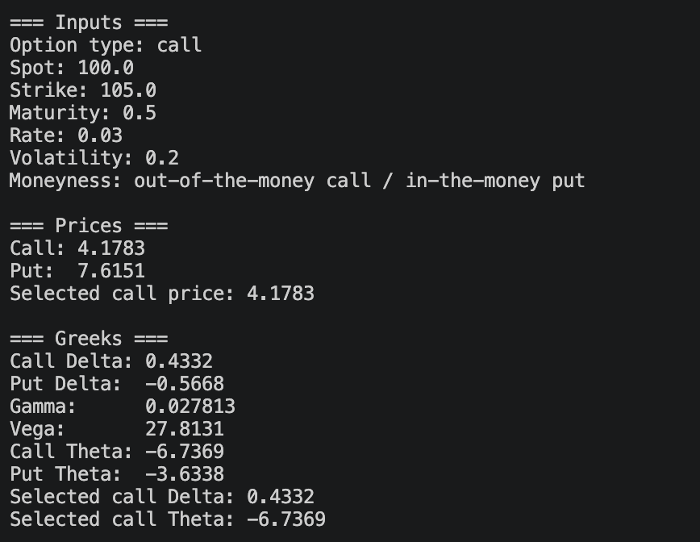
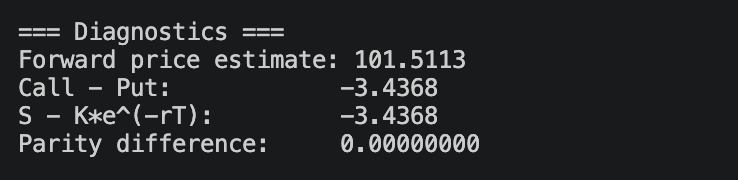
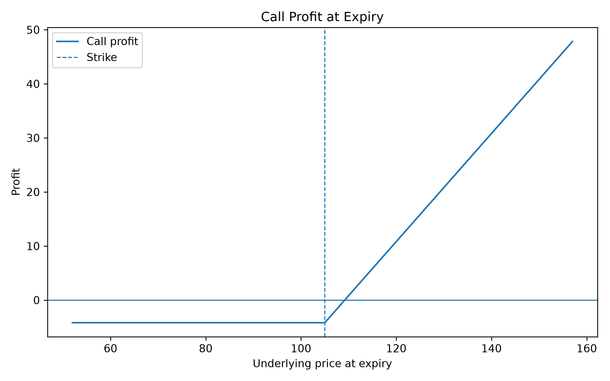

# Option Pricer

Python tool to price and analyze European options using Black-Scholes.

The project prices calls and puts, computes Greeks, checks put-call parity, runs spot and volatility sensitivity tests, estimates implied volatility, and plots profit at expiry.

## Example

A 6-month call, spot 100, strike 105, rate 3%, vol 20%:

Vega is for a 1.00 change in volatility (0.28 per vol point in this example), and theta is per year (about −0.018 per day).

## Why I built it

To better understand pricing, sensitivities, and hedging mechanics in practice.

## Features

- Prices European calls and puts
- Computes Greeks
- Checks put-call parity
- Runs spot and volatility sensitivity tests
- Estimates implied volatility
- Shows delta hedge intuition
- Plots option profit at expiry

## Files

- `black_scholes.py`: the core pricing functions implementing the Black-Scholes model
- `greeks.py`: option sensitivities (delta, gamma, vega, theta)
- `implied_vol.py`: implied volatility solver using Newton's method
- `pricer_app.py`: main script to run the pricer, diagnostics, sensitivity tests and payoff chart

## Run it

    pip install -r ../requirements.txt
    python pricer_app.py