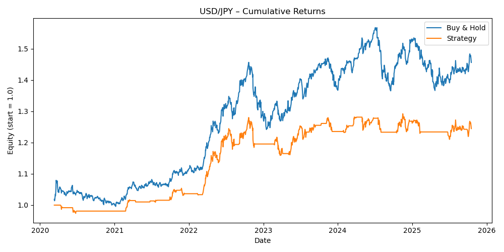

# Markets Portfolio

This is how I make sense of markets.

I'm a Master 2 Finance student at Sciences Po, and this repo is where I put everything I do on the side: market notes, a Black-Scholes pricer and FX backtests in Python.

I'm looking for a 6-month market finance internship in Paris from March 2027.
[LinkedIn](https://www.linkedin.com/in/emma-abeelack/) · abeelacke@gmail.com 

## If you only look at three things

**[Option Pricer](./03_option_pricer)**
Black-Scholes pricing, Greeks and implied volatility in Python.

**[FX Backtests](./05_systematic_backtests)**
Consists of a 20/50 moving average crossover with an ATR volatility filter on USD/JPY, EUR/USD and GBP/USD (2020–2025). The filter has cut drawdowns by roughly half on all three pairs, but it missed the big one-way USD/JPY trend that happenned in 2024–25.

| Pair | Strategy | Buy & hold | Sharpe | Max drawdown |
|---|---|---|---|---|
| USD/JPY | +24.5% | +45.6% | 0.64 | −9.4% |
| EUR/USD | +12.8% | +2.7% | 0.46 | −9.0% |
| GBP/USD | +18.7% | +2.8% | 0.61 | −5.1% |

**[Market Pulse](./01_market_routine)**
100+ notes since October 2025, where I try to link macro news to moves in rates, FX, equities and commodities.

## The rest of my project

- **[Macro Event Tracker](./02_macro_event_tracker)**: how the markets react to CPI, NFP and central bank decisions
- **[Macro Research](./04_macro_research)**: longer notes on energy, central banks and China (will add more)
- **[Instrument Notes](./06_instruments_notes)**: options, futures, FX forwards, bonds, swaps (my studying notes)
- **[Trading Journal](./07_trade_ideas)**: trade ideas with thesis, entry, invalidation and risk (working on it)

Python (pandas, NumPy, SciPy, matplotlib, yfinance), Jupyter.